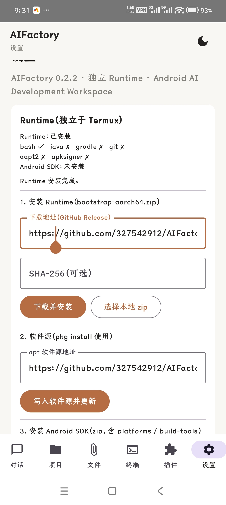

# AIFactory

> **📦 只想拿文件？** → **[下载总入口 / All downloads](https://github.com/327542912/AIFactory/releases/tag/downloads)** —— APK、Runtime bootstrap、Android SDK、Gradle 8.7 的直链、体积、sha256 全在这一页。
> 仓库里几个 release tag 各自只装一个文件，找不到东西时从这一页进。

**Android 上的自建 AI 开发工作台。不依赖 Termux，不用 proot，不复制 rootfs —— 整套 Linux 运行环境是从源码编译出来的，只把前缀里的包名换成了自己的。**

[](https://github.com/327542912/AIFactory/actions/workflows/build-aifactory-runtime.yml)
[](https://github.com/327542912/AIFactory/actions/workflows/android-build.yml)


-orange)

<p align="center">
  
</p>

---

## 这是什么

一台没 root 的 Android 手机上，要跑 `bash`、`java`、`gradle`、`git`、`apksigner`，最后在手机本地编出 APK —— 这条路通常要靠 Termux，或者靠 proot 套一个 rootfs。AIFactory 走的是第三条路：

**以 `termux-packages` 为构建系统，从源码把整套运行环境重编一遍，把二进制里面写死的前缀从 `/data/data/com.termux/files/usr` 换成 `/data/data/com.aifactory.app/files/usr`，作为本 App 的私有数据直接 `execve`。**

| 项 | 值 |
|---|---|
| 应用包名 / applicationId | `com.aifactory.app` |
| 当前版本 | `0.2.2`（versionCode 5） |
| `targetSdk` | **28**（硬性上限，见下） |
| `minSdk` / `compileSdk` | 26 / 34 |
| Runtime 前缀 | `/data/data/com.aifactory.app/files/usr` |
| 架构 | `aarch64`（arm64-v8a） |
| 是否需要 root / proot / Termux | 都不需要 |

### 为什么 `targetSdk` 必须是 28

Android 10（API 29）起，应用私有目录下的可执行文件被禁止直接 `execve`。`targetSdk 28` 才能让这个 App 执行自己 `files/usr/bin` 下的 ELF —— 这不是偷懒，是这套方案成立的**前提**。改回 34 会直接让整个 Runtime 无法启动。

### 为什么不用 proot

proot 靠 `ptrace` 拦截每个系统调用做路径重写，代价是：每次文件操作都多一次陷阱、线程数受限于调试器、`fork` 密集的构建（Gradle / CMake）慢一个数量级，而且 `ptrace` 在某些 ROM 的 seccomp 策略下直接被拒。改前缀重编虽然只做一次、要几十分钟，但**运行时是零开销的原生执行**。

---

## 快速开始（手机端）

### 1. 安装 App

从 [apk-latest](https://github.com/327542912/AIFactory/releases/tag/apk-latest) 下载 `AIFactory-0.2.2-debug.apk`（debug 签名，仅供自用）。

```text
https://github.com/327542912/AIFactory/releases/download/apk-latest/AIFactory-0.2.2-debug.apk
```

### 2. 安装 Runtime

打开 App → **设置** → 第 1 张卡「安装 Runtime」，地址默认已填好，直接点「下载并安装」（约 29.6 MB，解压后 3200+ 文件、1100+ 软链）。

### 3. 接入自建 apt 源

同一个页面第 2 张卡点「写入软件源并更新」。它做两件事：把 `etc/apt/sources.list` 里的 **官方 Termux 源整行注释**（官方包的路径前缀是 `com.termux`，装进来自建 Runtime 会静默坏掉），换成本仓库发布的自建平铺源：

```text
deb [trusted=yes] https://github.com/327542912/AIFactory/releases/download/runtime-repo/ ./
```

`Ign ... InRelease` 是平铺源 + `[trusted=yes]` 的正常现象，不是错误。

### 4. 装工具链

终端里：

```bash
# JDK / git / apksigner / zip / unzip 来自主源
pkg install -y openjdk-21 git apksigner zip unzip
```

**Gradle 别直接 `pkg install gradle`**——主源的 `gradle` 配方是 `1.9.0.0`（2014 年的 Gradle 1.9），
在 JDK 21 上起不来，更别说驱动 AGP 8.6。Gradle 8.7 单独放在补充源里：

```bash
echo 'deb [trusted=yes] https://github.com/327542912/AIFactory/releases/download/runtime-extra/ ./' \
  >> $PREFIX/etc/apt/sources.list
pkg update
pkg install -y gradle     # 装的是 8.7-1，落在 opt/gradle-8.7，bin/gradle 是指向它的 wrapper
gradle --version          # 应输出 Gradle 8.7
```

补充源与主源物理分开（`runtime-extra` 这个 tag），是因为 `runtime-repo` 每次流水线重跑都会整份重建，
手工塞进去的包会被覆盖掉。

装完回设置页，`java` / `gradle` / `git` / `apksigner` 四个 ✗ 会变成 ✓（判据是 `files/usr/bin` 下文件是否真实存在，不缓存状态；
Gradle 的判据额外要求 `opt/gradle-8.7/bin/gradle` 在，避免把 1.9 误判成"已装好"）。

也可以走 插件页 → 「Gradle / Android Build」→ 安装：它会把补充源写好、`pkg update`、再装这五个包。

### 5. 装 Android SDK

设置页第 3 张卡的地址已经预填好，直接点「下载并安装」：

```text
https://github.com/327542912/AIFactory/releases/download/sdk-latest/android-sdk-aarch64.zip
```

143,210,636 B，sha256 `70d10e0a7f180a510134f904b43f4a0c9c7b9dcdcbcb927493b5c8a6a966faa3`。
包里是 `platforms/android-34|35|36`、`build-tools/34.0.0|35.0.0|36.0.0`（aapt2/aapt/aidl/dexdump/split-select/zipalign 全是 aarch64 静态二进制）、
`platform-tools/adb`（arm64）。

**别去 Google 官方下载 `build-tools`**：官方 zip 里的 `aapt2` 是 x86_64 ELF，在手机上 `exec` 直接 `Cannot execute binary file`。
这份 zip 已经把可执行文件换成 aarch64 静态版（`lzhiyong/android-sdk-tools`），`lib/d8.jar`、`lib/apksigner.jar` 仍是官方 jar，可以照常 `java -jar`。


### 6. 在手机上编 APK

仓库自带闭环脚本（构建 → 验签 → 安装 → 启动 → 扫崩溃日志）：

```bash
cd ~/projects/<项目>
bash /path/to/AIFactory/scripts/device-build.sh    # 参数：项目目录、包名
# 产物：app/build/outputs/apk/debug/*.apk
```

脚本做的五件事：

1. **前置检查**：`java ≥17`、Gradle `≥8`（不是 8.7 会自动去补充源装）、`SDK/platforms`、`SDK/build-tools/*/aapt2`
   能在本机执行（架构不对在这里就挂，不会等到 Gradle 里报一堆看不懂的错）。
2. **构建**：写 `~/.gradle/gradle.properties`（`-Xmx1536m`、`daemon=false`），
   并以 `-Pandroid.aapt2FromMavenOverride=<SDK 里的 aapt2>` 调用 —— AGP 默认从 Maven 拉 x86_64 的 aapt2，
   在手机上执行不了，必须指向 SDK 里的 aarch64 版。
3. **验签**：`apksigner verify --print-certs`。
4. **安装**：同一台设备没法用 `adb` 装自己（adb 需要另一台机器或无线调试），
   所以优先走 Shizuku 的 `rish -c "pm install -r -t <apk>"`；没有 Shizuku 就打印手工路径。
5. **启动 + 崩溃检查**：`am start` → 6 秒后 `pidof` 判断进程存活 → `logcat -d` 抓 `FATAL EXCEPTION`。

完整日志写到 `~/.aifactory/logs/device-build-<时间>.log`，失败时最后一行会告诉你去哪看。

单独手搓（不用脚本）时注意：`build_termux.sh` 的 shebang 是 `#!/data/data/com.termux/files/usr/bin/bash`（历史遗留），
**在 Runtime 里必须用 `bash build_termux.sh` 调用**，直接 `./build_termux.sh` 会 `bad interpreter`。

---

## 构建与复现（GitHub Actions）

两套独立的流水线，都在 `.github/` 下，且**都只保留 `workflow_dispatch`**——早前挂着 `push` 触发器，每改一行代码都会误触发一轮 36 分钟的重编。

### A. Runtime（[`build-aifactory-runtime.yml`](.github/workflows/build-aifactory-runtime.yml)，分支 `master`）

```bash
gh workflow run build-aifactory-runtime.yml -f skip_bootstrap=false
```

| 输入 | 默认 | 含义 |
|---|---|---|
| `skip_bootstrap` | `false` | `true` = 跳过 bootstrap 重编，只编 apt 包（省 36–47 分钟） |
| `extra_packages` | 空 | 要**塞进 bootstrap zip** 的额外包；填 `none` 表示不打包 |
| `repo_packages` | 空 | 只发布到 **apt 源**的包，如 `openjdk-21,gradle`；填 `none` 表示不打包 |

常用组合：

| 目的 | 参数 |
|---|---|
| 全量重出 bootstrap | `skip_bootstrap=false`，其余留空 |
| 只补 apt 包（日常） | `skip_bootstrap=true`、`extra_packages=none`、`repo_packages=openjdk-21,gradle` |

流水线步骤（按执行顺序）：

1. `Checkout AIFactory` / `Checkout Termux build system` —— 后者是 fork `agnostic-apollo/termux-packages` 的 `infra-improvs` 分支
2. `Configure AIFactory package identity` —— 把包名/前缀写进构建系统
3. 五个确定性补丁：`swig` raw-insert 修 unbound、`docbook-xml` 换 oasis 镜像、`dos2unix`/`nano` 换活源、剔除 `command-not-found`、给全局 CMake 传 `-DCMAKE_POLICY_VERSION_MINIMUM=3.5`
4. `Preflight verify source hashes` —— 门禁：下载所有源包并逐字节比对 SHA256，404/410 硬失败、5xx 仅警告
5. `Build matching Android NDK Docker image`（约 5 分钟）
6. `Build ARM64 bootstrap`（**冷启动 36–47 分钟**）
7. `Normalize bootstrap prefix leftovers` —— 把 18 个 shell 脚本正文里残留的 `com.termux` 改掉（二进制跳过），并断言旧前缀 0 处
8. `Locate / Verify / Upload / Publish release` —— 发布到 `runtime-latest`
9. `Build extra packages` → `Publish apt repo` —— 发到 `runtime-repo`

**两个反直觉的细节**

- `build-bootstraps.sh` 里 `TERMUX_BOOTSTRAP_OUTPUT_DIRECTORY` 指向**仓库根目录**，不是 `output/`，zip 落在 `termux-packages/bootstrap-aarch64.zip`，所以定位用的是 `find . -maxdepth 3 -name 'bootstrap-aarch64.zip'`。
- `run-docker.sh` 是 `set -e` 的 `sh`，末尾的 trap 会把"构建成功"的退出码翻成 1 —— 日志明明打印了 `[*] Finished successfully`，步骤却红。workflow 里用 `set +e` 捕获 rc，**只以 zip 是否落盘为判据**，Upload/Publish 一律 `if: always()`。

**为什么没有缓存**：`run-docker.sh` 只挂载仓库目录，`~/.termux-build` 在容器内，runner 结束即销毁 —— 每轮都是从零冷编，这也是 36 分钟起步的原因。

### B. APK（[`android-build.yml`](.github/workflows/android-build.yml)，分支 `app-0.2.2`）

JDK 21 (temurin) + `setup-android` + `sdkmanager platforms;android-34 build-tools;34.0.0` + Gradle 8.7 → `gradle assembleDebug` → artifact `aifactory-debug-apk`。约 6–8 分钟。

> 仓库里**没有 gradle wrapper 目录**，CI 直接调 `gradle`，不要指望 `./gradlew`。

---

## 仓库结构

| 分支 | 内容 | 用途 |
|---|---|---|
| `main`（默认分支） | 只有 README + 文档 | 仓库门面；`workflow_dispatch` 要求 workflow 文件在默认分支 |
| `master` | runtime 构建流水线 + 补丁脚本 | 真正的 CI |
| `app-0.2.2` | App 源码（Compose）+ `android-build.yml` | 出 APK |
| `aifactory-*` | 历史快照 | 存档，App 仍为 0.1.0 / targetSdk 34，**不要直接用** |

Key 文件：

```text
.github/workflows/build-aifactory-runtime.yml   runtime 全流程（21 步）
.github/workflows/android-build.yml             APK 构建
.github/workflows/fixup-runtime-prefix.yml      已发布 zip 的一次性前缀修复
.github/scripts/normalize-bootstrap-prefix.sh   bootstrap 前缀归一化（构建内也会调用）
app/src/main/java/com/aifactory/app/
    Config.kt             RuntimePaths：硬编码 files/usr、默认三个下载地址
    RuntimeEngine.kt      exec 封装、环境变量、statusReport()（✓/✗ 的唯一判据）
    ArchiveInstaller.kt   解压 / 建软链 / chmod（不做路径重写）
    PluginsPage.kt        插件中心：apt 包 + 文件探针 + 实时安装输出
```

---

## 发布资产

**只想下载、不想看文档 → [`downloads`（下载总入口）](https://github.com/327542912/AIFactory/releases/tag/downloads)**，那里一张表列齐四个大文件的直链、体积、sha256。


| tag | 资产 | 说明 |
|---|---|---|
| [`runtime-latest`](https://github.com/327542912/AIFactory/releases/tag/runtime-latest) | `bootstrap-aarch64.zip` | 29,611,216 B，sha256 `45730c16…486343`（内含 runtime-repo + runtime-extra 两条源） |
| [`runtime-repo`](https://github.com/327542912/AIFactory/releases/tag/runtime-repo) | 261 个 `.deb` + `Packages` / `Packages.gz` / `Release` | 平铺 apt 源，含 `openjdk-21` / `git` / `apksigner` / `zip` / `unzip`；坏掉的 `gradle 1.9.0.0` 已从索引和资产里剔除；**流水线每次重跑整份重建** |
| [`runtime-extra`](https://github.com/327542912/AIFactory/releases/tag/runtime-extra) | `gradle_8.7-1_all.deb` + `Packages`（手动维护） | `gradle 1.9.0.0` 替代品，131,417,012 B，sha256 `027493b1…3ce09`；流水线不碰它 |
| [`downloads`](https://github.com/327542912/AIFactory/releases/tag/downloads) | `DOWNLOAD.md`（下载总表） | 四个大文件的直链 + sha256 + 装法，不含二进制 |
| [`sdk-latest`](https://github.com/327542912/AIFactory/releases/tag/sdk-latest) | `android-sdk-aarch64.zip` + `.sha256` | 143,210,636 B，sha256 `70d10e0a…6faa3`（3 个 platform + 3 个 build-tools + arm64 adb） |
| [`apk-latest`](https://github.com/327542912/AIFactory/releases/tag/apk-latest) | `AIFactory-0.2.5-debug.apk` + `.sha256` | 覆盖升级用固定签名 |

> **手工改 `runtime-repo` 的注意事项**：增删 deb 后 `Packages` / `Packages.gz` / `Release` 必须一起重建 —— 只换索引不换 `Release`，apt 会直接拒收并报
> `File has unexpected size (40057 != 40531). Mirror sync in progress?`。仓库里 `scripts/regen-repo-index.sh` 就是干这个的。

资产名固定、URL 稳定，App 里三个地址是写死的默认值，所以**不用改 App 就能换内容**。GitHub API 直传同名 asset 会 422，重发资产要先 `DELETE` 旧的。

---

## 已知限制

| 问题 | 现状 / 原因 | 出路 |
|---|---|---|
| `aapt2` 是 ✗ | 官方 `build-tools` 里的 `aapt2` 为 x86_64 ELF，arm64 上无法执行 | 已解决：SDK 包里换 aarch64 静态版，构建时传 `-Pandroid.aapt2FromMavenOverride` |
| 主源里的 `gradle` 是 1.9.0.0 | termux-packages 的配方就停在这个版本（Gradle 1.9 需要 JDK 8 时代环境） | 已用 `runtime-extra` 提供 Gradle 8.7（官方发行包重打包，`bin/gradle` 是 wrapper） |
| `termux-setup-storage` 失效 | `bin/am` 调的是 `com.termux.termuxam.Am` 类名，包名不同 | 自造 `am` 桥接，或改用 `curl` 直接拉文件 |
| 官方源不可用 | 官方包前缀是 `com.termux`，装进来路径全错 | 必须用自建 `runtime-repo` |
| 每轮冷编 36+ 分钟 | `~/.termux-build` 不在挂载目录内 | 把缓存目录也挂出来 / 用自托管 runner |
| 编 JDK 会撞 CMake 4 | 老配方写 `cmake_minimum_required(VERSION 2.8)`，CMake ≥ 4 直接报错 | 已在 workflow 里给全局 CMake 传 `CMAKE_POLICY_VERSION_MINIMUM=3.5` |
| `command-not-found` 已被剔除 | 它的 `generate-db.js` 拿官方镜像的 `Contents-<arch>.gz` 匹配 `bin/`，前缀不同必然失配并 `exit 1` | 需要的话自己生成索引 |
| 仓库无 LICENSE 文件 | Runtime 派生自 GPL-3.0 的 `termux-packages` | 分发二进制前先定许可，别直接商用 |

---

## 排错

| 症状 | 原因 | 处理 |
|---|---|---|
| 日志 `Finished successfully` 但步骤红 | `run-docker.sh` 的 trap 覆盖退出码 | 只看 zip 是否落盘，rc 忽略 |
| `CMake Error ... Compatibility with CMake < 3.5` | CMake 4 拒收老 `cmake_minimum_required` | 传 `-DCMAKE_POLICY_VERSION_MINIMUM=3.5` |
| `bad interpreter` | 脚本 shebang 仍是 `com.termux` 前缀 | 用 `bash script.sh` 调，或跑 `normalize-bootstrap-prefix.sh` |
| `pkg` 一执行就报找不到 `termux-setup-package-manager` | 脚本正文里残留旧前缀 | 同上，归一化后旧前缀必须 0 处 |
| `apt update` 报 `Ign ... InRelease` | 平铺源没有 `InRelease`，属正常 | 忽略；`Release` / `Packages` 拉到即成功 |
| 装完 `java` 仍 ✗ | JDK 在 `opt/openjdk/bin/java`，或安装中途失败 | 看设置页 `Runtime 安装完成` 之后手动 `ls files/usr/bin/java files/usr/opt` |
| 构建中断后再跑还是 36 分钟 | 无缓存 | 见「已知限制」 |

---

## 状态

- [x] 源码重编的 ARM64 bootstrap（自建前缀，已发布）
- [x] 自建 apt 源（`pkg install` 可用）
- [x] App 0.2.2：`targetSdk 28`、版本号读 `BuildConfig`、插件页数据驱动
- [x] JDK 21 / git / apksigner / zip / unzip 进 `runtime-repo`（264 个 deb，前缀全部核对过 0 处 `com.termux`）
- [x] Gradle 8.7 走独立 `runtime-extra` 源（绕开主源的 1.9.0.0）
- [x] Android SDK 单一 zip 覆盖 34/35/36 + arm64 adb
- [x] 固定签名 keystore：0.2.3 / 0.2.4 / 0.2.5 指纹一致，可覆盖升级不丢 `/data/data` 数据
- [x] `scripts/device-build.sh`：设备端构建 → 验签 → 安装（Shizuku）→ 启动 → 扫 `FATAL EXCEPTION`
- [ ] 设备端真跑通一次 `gradle assembleDebug`（脚本已就位，等你手机上跑）
- [ ] arm64 版 Android SDK 打包
- [ ] 设备端 `bash build_termux.sh` 出 APK 全链路跑通

---

## 致谢

构建系统来自 [termux-packages](https://github.com/termux/termux-packages) 及其 fork [agnostic-apollo/termux-packages](https://github.com/agnostic-apollo/termux-packages)。没有 Termux 团队十几年的配方积累，这套 prefix 重编方案不可能落地。
